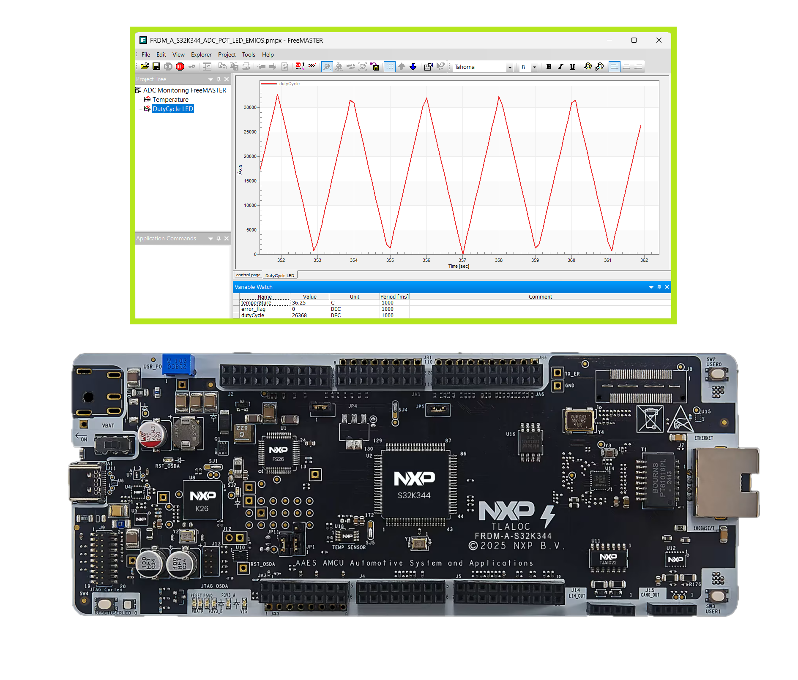
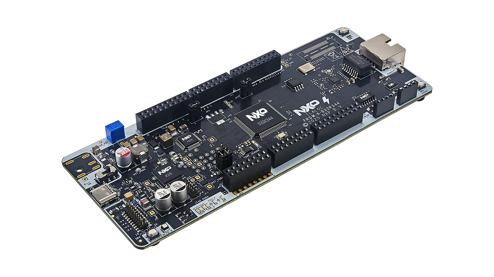
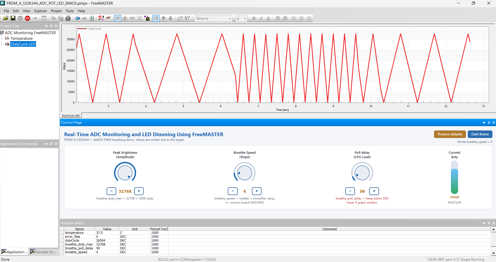

# NXP Application Code Hub

## Real-Time ADC Monitoring and LED Dimming Using FreeMASTER
This example demonstrates how to control the brightness intensity of an LED using the FreeMASTER debugging tool GUI on the FRDM-A-S32K344 development board, leveraging the eMIOS peripheral for PWM generation.

The example uses the AUTOSAR `Adc` driver TempSense API to continuously poll the on-die temperature sensor, converts the Q11.4 fixed-point result to degrees Celsius, and exposes the reading as a global variable (`temperature`) via the FreeMASTER real-time data visualization tool over LPUART6.
[

](./images/FRDM-A-S32K344_ADC_POT_LED_EMIOS.png)

#### Boards: FRDM-A-S32K344
#### Categories: Analog Front End, User Interface
#### Peripherals: eMIOS, ADC, UART
#### Toolchains: S32 Design Studio IDE

## Table of Contents
1. [Software and Tools](#step1)
2. [Hardware](#step2)
3. [Setup](#step3)
4. [Results](#step4)
5. [Support](#step5)
6. [Release Notes](#step6)

## 1. Software and Tools
This example was developed using the FRDM Automotive Bundle for S32K3 + S32M27. To download and install the complete software and tools ecosystem, use the following link:
- [ FRDM Automotive S32K3 + S32M27 Board Installation Package](https://www.nxp.com/app-autopackagemgr/automotive-software-package-manager:AUTO-SW-PACKAGE-MANAGER?currentTab=0&selectedDevices=S32K3&applicationVersionID=203)

In addition, the FreeMASTER run-time debugging tool is required to visualize the sensor data:
- [FreeMASTER Run-Time Debugging Tool](https://www.nxp.com/design/design-center/software/development-software/freemaster-run-time-debugging-tool:FREEMASTER)

## 2. Hardware
### 2.1 Required Hardware
- Personal Computer
- Type-C USB cable
- [FRDM-A-S32K344](https://www.nxp.com/design/design-center/development-boards-and-designs/FRDM-A-S32K344)[

](./images/FRDM-A-S32K344.png)

### 2.2 Debugger Connection
- Connect the Type-C USB cable to PC and FRDM-A-S32K344 board for power supply and debugging

## 3. Setup

### 3.1 Import the Project into S32 Design Studio IDE
1. Open S32 Design Studio IDE, in the Dashboard Panel, choose **Import project from Application Code Hub**.
   [

](./images/import_project_1.png)

2. Find the demo by searching: [Real-Time ADC Monitoring and LED Dimming Using FreeMASTER](https://mcuxpresso.nxp.com/appcodehub?search=dm-adc-pot-led-emios-s32k344)
3. Open the project, click the **GitHub link**, S32 Design Studio IDE will automatically retrieve project attributes, then click **Next>**.
    [

](./images/import_project_3.png)

4. Select **main** branch and then click **Next>**.

5. Select your local path for the repo in **Destination->Directory:** window. The S32 Design Studio IDE will clone the repo into this path, click **Next>**.

6. Select **Import existing Eclipse projects** then click **Next>**.

7. Select the project in this repo (only one project in this repo) then click **Finish**.

### 3.2 Generating, Building and Running the Example
1. In Project Explorer, right-click the project and select **Update Code and Build Project**. This will generate the configuration (Pins, Clocks, Peripherals), update the source code and build the project using the active configuration (e.g. Debug_FLASH).
Make sure the build completes successfully and the *.elf file is generated without errors.
[

](./images/update_and_build.png)
Press **Yes** in the **SDK Component Management** pop-up window to continue.

2. Go to **Debug** and select **Debug Configurations**. There will be a debug configuration for this project:
[

](./images/Debug_config.png)

        Configuration Name                  Description
        -------------------------------     -----------------------
        $(example)_debug_flash_pemicro      Debug the FLASH configuration using PEmicro probe

    Select the desired debug configuration and click on **Debug**. Now the perspective will change to the **Debug Perspective**.
    Use the controls to control the program flow.

### 3.3 How It Works
After initializing the MCU clocks, pin mux (`Siul2_Port_Ip_Init` and `Port_Init`), eMIOS PWM, LPUART, and ADC (including a self-calibration pass with `Adc_Calibrate`), FreeMASTER is configured to use **LPUART6** as its serial transport via `FMSTR_SerialSetBaseAddress((FMSTR_ADDR)IP_LPUART_6_BASE)`, then initialized with `FMSTR_Init()`.

The application drives a non-blocking **"breathing" LED** effect on an eMIOS PWM channel: the duty cycle ramps up and down in a smooth triangular pattern using `Pwm_SetDutyCycle()`. The brightness updates on every loop pass — `FMSTR_Poll()` is called first so the FreeMASTER link never times out, followed by a short `TestDelay(breathe_poll_delay)` that paces both the animation speed and the serial polling rate.

Three global variables tune the effect and can be watched and changed live from FreeMASTER:
- `breathe_duty_max`  - peak brightness (PWM duty, `0x8000` = 100%).
- `breathe_speed`     - brightness change applied on every loop pass (smaller = smoother, slower ramp).
- `breathe_poll_delay` - simulates the CPU load; higher values will affect FreeMASTER link reliability.

In parallel, `Adc_TempSenseGetTemp()` reads the on-die temperature sensor; the Q11.4 result is converted to degrees Celsius into the global `temperature` variable, and `error_flag` is set if a conversion fails. The live PWM duty is mirrored in `dutyCycle`.

**User controls:** two board push-buttons (SW2/SW3, detected via ICU falling-edge interrupts) increase/decrease `breathe_speed`. The same control is also available from the PC: a custom FreeMASTER control page (`include_freemaster/breathing_control.htm`) provides knobs and +/- buttons that read and write these variables in real time.

## 4. Results
Results are visualized using the [FreeMASTER Run-Time Debugging Tool](https://www.nxp.com/design/design-center/software/development-software/freemaster-run-time-debugging-tool:FREEMASTER) PC application.

1. After generating the .elf file, run the application on the FRDM-A-S32K344 board.
2. Open **FreeMASTER** on your PC and load the `FRDM_A_S32K344_ADC_POT_LED_EMIOS.pmpx` project file.
3. In FreeMASTER, click the **GO!** green button (**Start Communication**) to connect; it will search the COM port of the board at baud rate **115200**.
4. The `temperature` variable will update in real time, showing the on-die temperature in degrees Celsius.
5. If the ADC conversion fails, the `error_flag` variable will be set to `true`.
6. Use the knobs `Peak brightness` and `Breathe Speed` to change the `dutyCycle` variable; this will update the LED behavior in real time.
7. See the changes in the `DutyCycle LED` plot on the FreeMASTER application below:
[

](./images/FRDM-A-S32K344_ADC_POT_LED_EMIOS_FM.png)

## 5. Support
For general technical questions related to NXP microcontrollers, please use the [NXP Community Forum](https://community.nxp.com/).
#### Project Metadata

<!----- Boards ----->

<!----- Categories ----->

<!----- Peripherals ----->

<!----- Toolchains ----->

Questions regarding the content/correctness of this example can be entered as Issues within this GitHub repository.

>**Note**: For more general technical questions regarding NXP Microcontrollers and the difference in expected functionality, enter your questions on the [NXP Community Forum](https://community.nxp.com/)

## 6. Release Notes
| Version | Description / Update                           | Date                           |
|:-------:|------------------------------------------------|-------------------------------:|
| 1.0     | Initial release on Application Code Hub        | October 8th 2026	|
